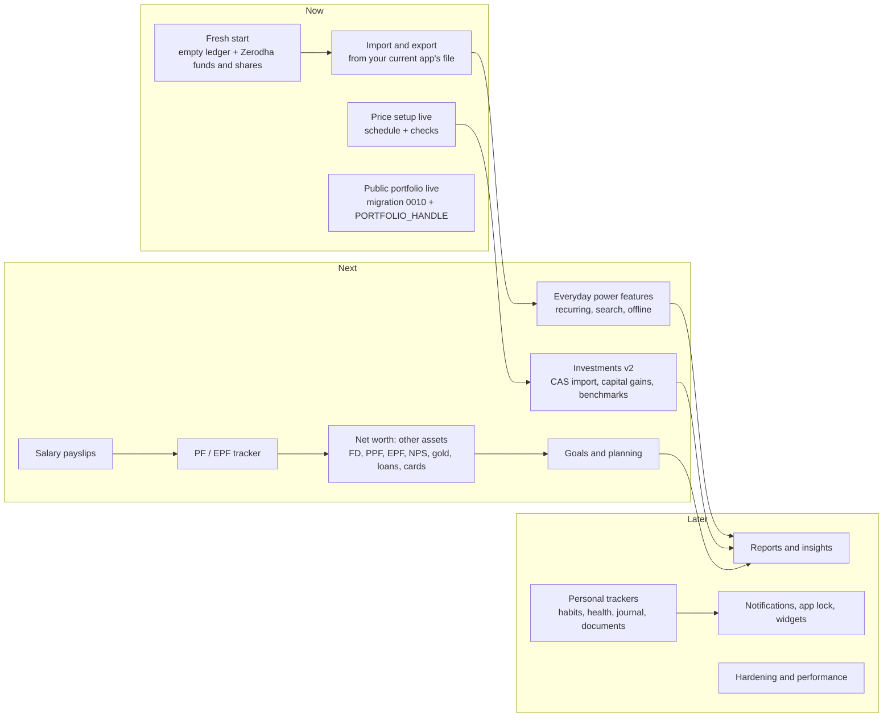

# Ledgerly roadmap (October 2026)

What is done, what comes next and why, and the longer plan for the app. The architecture behind
it is in [`ARCHITECTURE.md`](ARCHITECTURE.md); decisions are in [`decisions/`](decisions/README.md).

## Where we are

| Area                        | Status          | Notes                                                                                                                                        |
| --------------------------- | --------------- | -------------------------------------------------------------------------------------------------------------------------------------------- |
| Expo app, design system, CI | Done            | Web on Vercel (`ledgerly`); iOS/Android from the same code                                                                                   |
| Sign-in and security        | Done            | Allowlisted sign-up, two-step sign-in (TOTP, aal2 in the database), sessions, idle sign-out                                                  |
| Expense manager             | Done, saved     | Transactions, calendar, stats, budgets, categories, accounts, people and splits, receipts                                                    |
| Notes                       | Done, saved     | Text and checklists, colours, pins, labels, archive, reminders, Recently deleted (migration 0015)                                            |
| Mutual funds                | **Done, saved** | AMFI search, purchases/SIPs/redemptions/dividends, SIP plans with due and missed instalments, FIFO cost, XIRR, allocation, growth, AMFI NAVs |
| Stocks                      | **Done, saved** | Buys, sells, dividends, bonus, splits, FIFO P&L, XIRR, sectors, day change, end-of-day prices                                                |
| Tradebook import            | **Done**        | Zerodha tradebooks (.xlsx/.csv) read on the device; you review each trade and approve before anything is saved                               |
| Overview                    | Done            | Net worth includes funds, stocks and PF                                                                                                      |
| Salary & PF                 | **Done, saved** | Payslips per employer and month across job changes, FY totals and TDS; PF passbook, interest estimate, pension apart (migration 0016)        |
| Export everything           | **Done**        | One JSON file with all your data (Settings)                                                                                                  |
| Public portfolio            | **Built**       | The site's home page, edited in Dashboard → Portfolio and published as a snapshot; Dashboard button opens the app; needs migration 0010      |
| Old app's data              | Retired         | Not imported (your decision) and deleted from the database. The ledger starts from scratch                                                   |
| App-wide Reports, Insights  | Not built       | Hidden from the app until they work; fund insights are under Mutual funds                                                                    |
| Receipt photos              | **Done, saved** | Private Storage bucket, one-minute links; needs migration 0011                                                                               |
| Expense extras              | **Done**        | Recurring entries (migration 0012), search with totals, CSV export, calculator in the amount; the calendar is the default view               |
| Fund extras                 | **Done**        | Capital gains by financial year, goals, expense ratio and yearly cost, similar-fund hint, SIP step-up (migration 0013)                       |
| Shares vs index             | **Done**        | Your shares against an index fund you choose (Nifty 50 to begin with), same money on the same dates (migration 0014)                         |

> **October 2026:** the old Vite app and its data were retired. `supabase/migrations` holds
> everything a new project needs (0004 foundation, then 0005–0017), and CI installs it on an
> empty database on every change.

## The plan in one picture

## Now

### Fresh start (October 2026)

You chose not to bring the old app's data over. Instead:

- **The old app's tables were permanently deleted** (`user_workspaces`,
  `public_portfolios`) and the functions that wrote them. The planned import (a check report,
  then import) was built and then withdrawn before it was ever run
  ([ADR 0008](decisions/0008-start-from-scratch.md)).
- **Funds and shares from Zerodha**
  (a one-time SQL load, run once and since removed from the repository): every SIP instalment, buy and sale from your Zerodha tradebooks,
  checked against your Kite holdings (units, invested and shares match). It replaced a first load
  from the Excel tracker, which lacked trades the tradebooks have.
- The expense manager starts empty: **Add starter categories** sets up the usual categories and a
  Cash account in one tap.

### Tradebook import (October 2026)

Mutual funds or Stocks → **Import**: choose Zerodha Console tradebooks, review every trade the
app would add (with units and invested amount before → after, and what is already in the app),
switch off any holding, then **Approve and add**. Files are read on the device and nothing is saved
before you approve ([ADR 0009](decisions/0009-tradebook-import-on-device.md); how it works:
[`INVESTMENTS.md`](../features/INVESTMENTS.md#import-a-tradebook-zerodha)). Needs migration 0009.

### Public portfolio (October 2026)

A public developer site (`apps/portfolio`) whose content you manage under Dashboard →
**Portfolio**: profile, links, projects with case-study pages, skills, experience, education and
certifications, numbers and highlights, "beyond the code" sections, and contact messages. Items
can be drafts and reordered; **Preview** opens a private 20-minute link; **Publish** makes your
changes live within about a minute, with no redeploy. It is the home page of the site, and its
**Dashboard** button opens the app ([ADR 0010](decisions/0010-public-portfolio-site.md),
[ADR 0011](decisions/0011-portfolio-at-the-dashboard-address.md); how it works:
[`PORTFOLIO.md`](../features/PORTFOLIO.md)). To go live: run migration 0010, add
`PORTFOLIO_HANDLE` to the Vercel project ([details](../../apps/portfolio/README.md#deploy-on-vercel)),
add content, Preview, Publish. Later: email notification of new messages, analytics.

### Import and export (waiting for your export file)

You will share an export from the app you use today; the importer is built around that file:
upload, match its columns, a preview with duplicates flagged, then import. It runs on the server
and the file is not kept. Export from Ledgerly comes with it, in the same shape.

### Price updates live (done)

`market-refresh` is deployed from GitHub Actions and runs every weekday at 23:45 and 07:00 IST
(fund NAVs from AMFI and exchange closing prices at the same time), and on **Update prices**.
Each run is logged in `market_refresh_runs`. AMFI's current eight-column file is read, and the
function answers only the project's own web addresses.

## Next

### From the October 2026 audit

Small, high-value engineering steps ([report](AUDIT_2026-10.md)):

1. ~~Reload data when coming back to the app~~ (done: at most once a minute, never over an
   unsaved edit).
2. ~~Decide on the placeholders~~ (done: hidden until built). Build search and data export next.
3. ~~Store receipt photos~~ (done: private `receipts` bucket, migration 0011).
4. ~~Route-level code splitting~~ (done: screens load on demand, subset fonts; first load
   ~440 KiB, see [ADR 0012](decisions/0012-web-loads-screens-on-demand.md)).
5. Load history by period instead of all at once, when the ledger grows large.

### PF / EPF and salary payslips (done)

Built October 2026 (migration 0016), independent of any one company: payslips name their
employer, and the PF account follows you between jobs as under one UAN.

- Payslips with the lines as printed, EPF/VPF/TDS and the employer's shares; net pay can record the
  income entry; totals by financial year and per employer.
- The PF passbook: contributions from payslips (or by hand), yearly interest at the rate you enter
  (with an EPFO-style estimate to check against), withdrawals, opening balances; pension apart;
  PF in net worth.
- Still to come: a reminder for months without a payslip, payslip PDFs in private storage, and
  employer-wise transfer entries if an old PF account was never merged.

### The rest of the Excel tracker

Fund and equity history now comes from Zerodha. PF history, salary rows and digital gold come in
with the PF tracker, the payslips and the other-assets module. Sheets with passwords or identity numbers
are never read or stored.

### Everyday power features

- ~~Recurring entries~~ and ~~search with totals~~ (done). Next: saved filters, and search across
  notes and entries together.
- Offline add queue on phones (entries made without a connection are sent later).

### Investments v2

- **Consolidated account statement (CAS) import** from CAMS/KFintech PDFs: every fund and
  transaction in one go. Parsed on the server; the PDF password is used once and never stored.
- **Other brokers' tradebooks** (Groww, Upstox and others), with the same review and approve
  step as the Zerodha import.
- ~~**Capital gains by financial year**~~ (done for funds). Still to come for shares: FIFO lots, short/long term by holding period, grandfathered
  cost for older equity; tax estimates only with rates that name their source and year.
- **Dividends and corporate actions** calendar; prompts when a held share has a bonus or split.
- ~~**Benchmark comparison**~~ (done: Stocks → vs Index).
- **Portfolio health**: overlap between funds, expense ratio drag (direct vs regular), category
  concentration, top holdings across funds (from AMFI/AMC portfolio disclosures).
- **SIP autopilot** (opt-in): records each instalment at the published NAV after the allotment
  date; you only confirm.
- **Live prices** behind the same tables if a provider is chosen (decision below).

### Net worth: everything you own and owe

- Fixed and recurring deposits (interest accrual and maturity), PPF, EPF, NPS (contributions plus
  statement value), gold and silver (sovereign gold bonds, physical), real estate (manual
  valuations), cash in hand.
- Loans with EMI schedules and a prepayment calculator; credit cards with statement cycles and due
  dates.
- Insurance policies: cover, premium and renewal dates.
- A daily **net worth snapshot** (server job) for a true net-worth-over-time chart.

### Goals and planning

- Goals with a target amount and date (house, car, education, emergency fund, retirement), linked
  to accounts, funds and stocks.
- Progress and the monthly SIP needed, with return assumptions **you** enter (no hard-coded
  returns), and a range from cautious to hopeful.
- Emergency fund (months of expenses covered) and retirement corpus calculators.

## Later

### Reports and insights

- Monthly review: income, spending by category, savings rate, net worth change, investment
  performance; exportable CSV and PDF.
- Rule-based insights first: unusual spending, budget pace, idle cash, SIPs missed, FD maturing,
  card due, insurance renewal.
- Optional AI summaries, **off by default**: only with an explicit opt-in setting, only
  aggregates (never raw notes or account numbers), and never required for any feature.

### Personal trackers (beyond money)

One generic **tracker engine** instead of a new module per idea: a tracker is a definition
(name, type: number, yes/no, duration, 1–5 scale or text; unit; goal; schedule) plus dated entries.
Streaks, charts and reminders are shared. On top of it, ready-made trackers:

| Tracker              | What it covers                                                                            |
| -------------------- | ----------------------------------------------------------------------------------------- |
| Habits               | Daily or weekly habits with streaks and reminders                                         |
| Health               | Weight, sleep, workouts, steps, water (manual first; Apple Health / Health Connect later) |
| Journal and mood     | Daily note with mood and tags; optional end-to-end encryption                             |
| Documents            | Private, encrypted storage for IDs, policies and warranties, with expiry reminders        |
| Important dates      | Birthdays, anniversaries, renewals, warranties                                            |
| Vehicle              | Fuel, service log and reminders (spending links to the ledger)                            |
| Reading and learning | Books, courses, progress                                                                  |

A daily **Today** view brings them together: tasks due, habits to tick, bills and SIPs due, and a
quick add for anything.

### Platform

- **Notifications**: push (Expo) and email from an Edge Function and schedule: SIP due, bill or
  card due, budget limit, price alert, document expiry, weekly review.
- **App lock** with Face ID / fingerprint on phones; **privacy mode** that hides amounts.
- Installable web app; home-screen widgets on phones.
- **Incremental sync** (changes since a cursor) and per-area loading when data grows; offline cache.
- ~~Export everything as JSON~~ (done). Next: scheduled encrypted backups, an import of that
  file, account deletion.

### Hardening and performance

- Threat-model review with tests for each control. CI already installs every migration on an
  empty database; the behaviour tests for each migration (run locally before it ships) can join it.
- Performance budgets per screen; the first load (~440 KiB) is mostly framework, so the 350 KiB
  target needs a lighter framework rather than more splitting (ADR 0012).
- Error reporting with a scrubber that never sends amounts, notes or tokens (optional Sentry).

## What premium apps do, and how we do it

| Feature                       | Common in                        | Here                                                                 | When         |
| ----------------------------- | -------------------------------- | -------------------------------------------------------------------- | ------------ |
| Net worth across all assets   | INDmoney, Kuvera, Monarch        | Ledger + funds + stocks today; other assets and daily snapshots next | Next         |
| Fund import from CAS          | INDmoney, Kuvera, Value Research | Server-side PDF parsing, password used once                          | Next         |
| XIRR per fund and portfolio   | Kuvera, Groww, Zerodha Console   | Done                                                                 | Done         |
| Capital gains report          | Kuvera, Zerodha Console          | FIFO lots ready; report next                                         | Next         |
| Fund overlap and expense drag | Value Research, INDmoney         | From AMFI/AMC disclosures                                            | Next         |
| Budgets and category trends   | YNAB, Money Manager              | Done                                                                 | Done         |
| Recurring and bill reminders  | Monarch, Copilot                 | Recurring entries + notifications                                    | Next / Later |
| Goals with projections        | Kuvera, Monarch                  | Your own return assumptions, ranges                                  | Next         |
| Shared expenses and settle-up | Splitwise                        | Done (people, splits, repayments)                                    | Done         |
| Habits, health, journal       | Streaks, Daylio                  | Generic tracker engine                                               | Later        |
| Document vault                | DigiLocker-style apps            | Encrypted private storage with expiry reminders                      | Later        |
| AI assistant                  | Copilot, Monarch                 | Off by default; aggregates only; rules first                         | Later        |

## Decisions needed from you

1. Share the export file from the app you use today, so the importer can be built around it.
2. Live share prices: stay end of day (free), or pick a provider (paid feed or a broker API) whose
   terms allow personal use? Its key would live only in a function secret.
3. Phone app stores, or the installable web app first?
4. After the import, PF / EPF and salary: Investments v2 or the other assets first?
5. Tax estimates: show only gains and holding periods, or estimate tax with dated, sourced rates?
6. Personal trackers: which three matter most to you (habits, health, journal, documents, dates)?

### Decided (October 2026)

- Start from scratch: the old app's data is not imported and is deleted. Funds and shares are
  loaded once from the Zerodha tradebooks, directly in the database.
- Then import and export built around the export of the app you use today; then the PF / EPF
  tracker; then salary as full payslips.
- Parents' finances stay out of the app.
- Passwords are never stored in the app (use a password manager and two-step sign-in on those
  accounts).

## Rules that hold for every phase

- No service-role or secret keys in the app; only the publishable key, protected by RLS.
- Authorization is enforced in the database (RLS, checks, RPCs); screens and route guards are only
  convenience.
- Market data and other third-party data are fetched on the server, never from the browser, and
  never hard-coded.
- No financial data or tokens in logs; no financial data sent to external AI services by default.
- No hard-coded personal balances; sample data stays clearly labelled and only in preview mode.
- We do not claim the app cannot be hacked; we reduce risk and test the controls.
