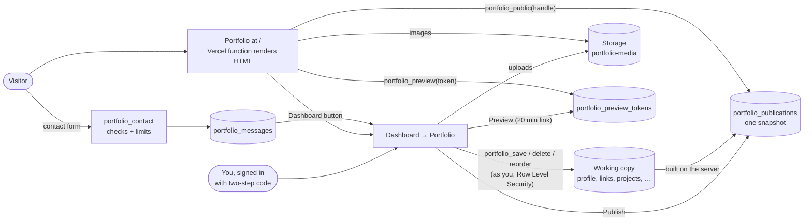

# Public portfolio

A public developer site (`apps/portfolio`) whose content you manage in the dashboard
(**Portfolio**), published when you choose, with no redeploy. It is the **home page of the
dashboard's address**: visitors land on the portfolio, and its **Dashboard** button opens
`/dashboard`, which asks you to sign in. Why it is built this way:
[ADR 0010](../architecture/decisions/0010-public-portfolio-site.md) and
[ADR 0011](../architecture/decisions/0011-portfolio-at-the-dashboard-address.md).

## Editing (dashboard → Portfolio)

| Tab        | What you edit                                                                                                                                                                                                       |
| ---------- | ------------------------------------------------------------------------------------------------------------------------------------------------------------------------------------------------------------------- |
| Profile    | Name, title, headline, rotating phrases, intro and About text, photo, résumé PDF, location and time zone, public email, availability, site address and URL, search and social preview, sections to hide; your links |
| Projects   | Title, page address, tagline, summary, cover, status, role, period, technologies, key features, overview, challenges, architecture, screenshots and diagrams, links, colour, featured                               |
| Skills     | Skill areas, and in each the skills with an icon, optional level and short note; featured skills appear in the hero                                                                                                 |
| Experience | Company, client, role, dates (no end date = current), summary, responsibilities, highlights, achievements, technologies                                                                                             |
| Education  | Degrees, certifications, courses and awards with issuer, dates, credential link, grade, note and image                                                                                                              |
| More       | Numbers (counted up in the hero), highlights and milestones (About), and "Beyond the code" sections (interests, writing, experiments)                                                                               |
| Messages   | What visitors sent through the contact form: read, mark, reply by email, delete                                                                                                                                     |

- **Every item can be a draft.** The eye button hides an item from the site without deleting
  it. Arrows reorder; the site shows items in the same order.
- **Text formatting.** Longer fields take a small Markdown subset: paragraphs, `###` headings,
  lists, `>` quotes, code, `**bold**`, `*italic*` and `[links](https://…)`. Links must be https
  (or mailto). Nothing is ever inserted as raw HTML.
- **Images.** In the web dashboard an image is resized to WebP (up to 1600 px, plus a 640 px
  copy for small screens) before upload, and needs a short description for screen readers. PDF
  up to 5 MB for the résumé. Phone apps: images only, not yet tried on a device.
- **No invented numbers.** Skill levels are optional (Learning to Expert, shown as 1–5 marks) and
  shown only when you set one; there are no percentages. Numbers in the hero are exactly what
  you enter.
- **Checks.** The form explains problems next to the field. The database applies the same rules
  again and refuses anything else (unknown columns, http links, a slug used twice, an end date
  before the start).

## CV download (Portfolio → CV)

The **CV** tab builds a CV from the portfolio's visible items (unpublished edits included) and
downloads it as **PDF** or **Word** (`Firstname-Lastname-CV.pdf` / `.docx`), made on the device.

- **Layout for ATS:** one column, standard headings (Professional Summary, Skills, Work
  Experience, Projects, Education, Certifications), real text in reading order, dates beside
  each title (right-aligned dates are read out of order by PDF parsers), no tables, images,
  icons, headers or footers. The PDF uses the standard Helvetica fonts; the Word file uses
  Calibri and a real heading style.
- **Content:** name, title, contact line (public email or Email link, the phone typed on the
  tab, location, LinkedIn/GitHub/website links, the site's address), summary from
  Introduction (up to 80 words), skills by area, roles newest first (key contributions,
  achievements, then responsibilities; up to 8 for the latest role, 6 for others; technologies
  line), up to 4 projects (featured first), degrees, then certifications, courses and awards.
- **Phone:** typed on the tab for the download only; never saved, so it never reaches the
  public site.
- **ATS readiness:** Ledgerly's own score out of 100 from common guidance: parsable layout,
  email, phone, title, a 25–100 word summary, 8+ skills, dated roles with bullets, 3+ bullets
  per role, numbers in 30% of role bullets, action-led bullets, bullets under 35 words, 300–1,100
  words, education or certifications. Paste a job description to see which of its keywords
  the CV has (then 60% checklist, 40% keyword match). Checked on the device; real ATS scores
  differ by employer.
- **Code:** `lib/domain/cv/` (build, layout, ATS check, keywords, PDF and Word writers;
  tested, including a read-back of the text order), `features/portfolio-site/cv/`. Web only for
  now (phones need a file module).

## Preview and publish

- The bar at the top shows **Changes not published** or **Up to date**, and the live version.
- **Preview** opens `/preview#t=…` on this site (or on the "Public site URL" from Profile, if
  the portfolio runs elsewhere): a snapshot of your working copy, drafts included and marked. The
  link works for 20 minutes and only on that browser tab's session; the token sits after `#`, so
  it is never sent to a server log.
- **Publish** replaces the live snapshot with your visible items. The site shows it within about
  a minute (pages are cached for 60 seconds and the page re-checks when older than 30 seconds).
  Images that nothing uses any more, and that are over an hour old, are then deleted.
- **Take the site offline** (Profile) removes the published snapshot; visitors get a "not
  published" page (404). Your working copy is kept.

## The public site

- **Pages:** `/` (hero, work, stack, experience, about, credentials, beyond the code, contact),
  `/projects/<address>` (case study, with a link to the next project), `/preview`, `/sitemap.xml`,
  `/robots.txt`. Sections with no content, or hidden in Profile, are left out.
- **Dashboard button:** a small "Dashboard" pill at the end of the header (phones: the last line
  of the menu, and on the "nothing published yet" page) opens `/dashboard`. It is `nofollow`, and
  dashboard pages send `noindex`, so search engines list only the portfolio.
- **Rendered on the server** with title, description, canonical link, Open Graph and Twitter
  cards and JSON-LD (`Person`; `SoftwareSourceCode` or `CreativeWork` for projects). The page works before
  any script runs.
- **Motion:** the name assembles, sections reveal on scroll, numbers count up, a canvas draws
  your skills as a field (featured ones lit), project pages open with a view transition. With
  `prefers-reduced-motion` (or no JavaScript) everything is shown still.
- **States:** a missing project is a 404 page; if the database cannot be reached the site
  answers 503 and retries in the browser; an unpublished portfolio is a 404 "not published"
  page. Expired previews say so.
- **Size:** about 80 KiB of JavaScript and 10 KiB of CSS (gzip), checked in CI (budgets 110 and
  16 KiB). Fonts (Geist, Geist Mono, Instrument Serif) are self-hosted.

## Contact form

The form posts to `portfolio_contact`, which:

1. accepts only a published portfolio whose contact section is shown;
2. checks name (1–100 characters), email and message (10–4000 characters, at most 3 links);
3. silently drops a submission that fills the hidden field or arrives under 2.5 seconds after
   the page loaded (the bot is told it worked);
4. allows 3 messages per 10 minutes and 10 per day from one network (counted by a salted hash
   of the IP, kept for a day; the IP itself is never stored), and 100 per day in total;
5. stores the message for you. **No email is sent**: check Messages in the dashboard.

These limits make abuse slow and bounded, not impossible. Messages are visible only to you.

## Data

| Table                                                                                                                                                                                              | Purpose                                    | Who can read / write                                                      |
| -------------------------------------------------------------------------------------------------------------------------------------------------------------------------------------------------- | ------------------------------------------ | ------------------------------------------------------------------------- |
| `portfolio_profile`, `portfolio_links`, `portfolio_facts`, `portfolio_skill_groups`, `portfolio_skills`, `portfolio_projects`, `portfolio_experience`, `portfolio_education`, `portfolio_sections` | Working copy                               | You only (two-step sign-in), audited by column name                       |
| `portfolio_publications`                                                                                                                                                                           | The published snapshot, built by a trigger | You; visitors only through `portfolio_public(handle)`                     |
| `portfolio_preview_tokens`                                                                                                                                                                         | Preview snapshots (token hash, 20 minutes) | You; visitors only with the link, through `portfolio_preview`             |
| `portfolio_messages`                                                                                                                                                                               | Contact messages                           | You read, mark and delete; visitors only add, through `portfolio_contact` |
| `internal.portfolio_contact_attempts`, `internal.portfolio_salt`                                                                                                                                   | Rate limiting                              | Nobody through the API                                                    |
| Storage bucket `portfolio-media`                                                                                                                                                                   | Images and résumé, under your user id      | Public read; you add and delete (two-step sign-in), never overwrite       |

## Setup

1. Run `supabase/migrations/202610120010_portfolio.sql` (see
   [`SUPABASE_SETUP.md`](../../SUPABASE_SETUP.md#public-portfolio-migration-0010)).
2. In the existing Vercel project (`ledgerly`) add the variable
   `PORTFOLIO_HANDLE` (e.g. `your-name`) and redeploy. The portfolio uses the dashboard's own
   Supabase settings ([`apps/portfolio/README.md`](../../apps/portfolio/README.md#deploy-on-vercel)).
3. In the dashboard → Portfolio → Profile, set the site address (handle) to the same value as
   `PORTFOLIO_HANDLE`; add content; Preview; Publish. Leave "Public site URL" empty: the
   portfolio is this site's home page.

## Not included (yet)

- Email or push notification of new messages (needs an Edge Function and a mail provider).
- Analytics, a blog, several languages, custom themes per section.
- Choosing PDFs in the phone apps, and downloading the CV there.
